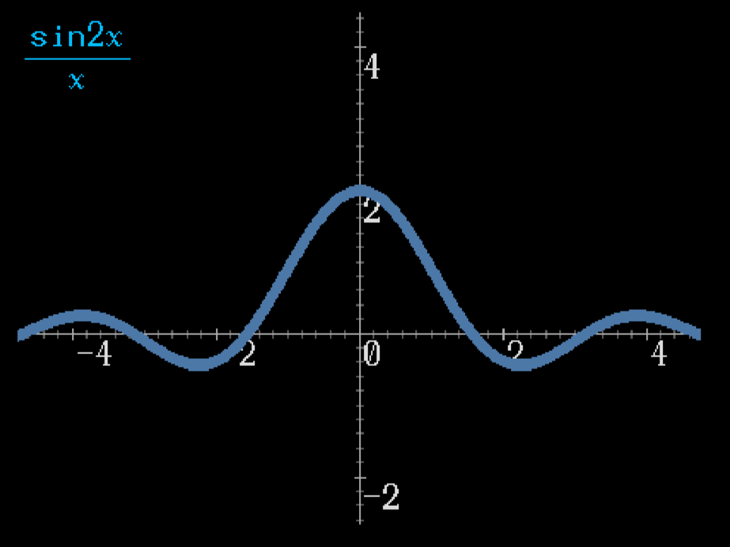

# DrawGraph
ビットマップ上に2Dグラフを描画する

- SciCalc, MathRendererと連動
- C++標準ライブラリのみを使用しており、OSに非依存
    - SciCalc, MathRendererが必要です

# DEMO



# Installation

MSVCの場合
```
mkdir build
cd build
cmake ..
cmake --build . --config Release
cmake --install .
```

GNUCの場合
```
mkdir build
cd build
cmake ..
cmake --build .
cmake --install .
```

# Dependencies

- SciCalc
- MathRenderer

# Description

ビットマップ上に2Dグラフを描画します。
現時点では、陽関数（$y=f(x)$ の形で表される関数）のプロットにのみ対応しています。

数式の入力には、MathRendererで使用する入力トークン列（`std::vector<math_renderer::Token>`）を使用します。
なお、SciCalcで使用する数式文字列（`std::string`）を使用することも可能です。
MathRendererの入力トークン列を使用する場合、プロット画面の左上に数式が描画されます。
SciCalcの数式文字列を使用する場合、数式は描画されずにグラフだけが描画されます。
